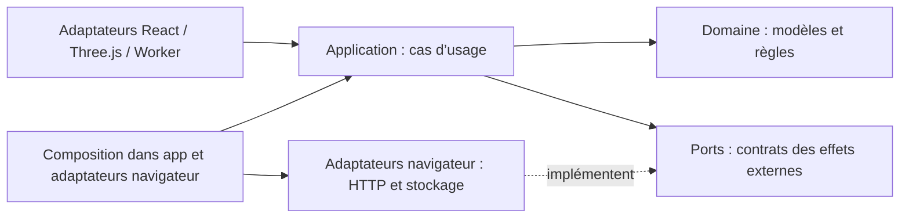

# Architecture hexagonale par domaine métier

Le client est un monolithe modulaire. Chaque domaine possède son modèle et ses règles ; les dépendances techniques restent dans les adaptateurs. Les modules partagent un processus et une sauvegarde, sans multiplier les services réseau.

```text
src/
  app/                         composition React et orchestration du jeu
  modules/
    farm/                      parcelles, cultures, simulation, hydratation
    robots/                    robots, statistiques, capacités, flotte
    construction/              bâtiments, recettes, capacités, inventaire
    equipment/                 équipements, coûts, installation dans l’atelier
    research/                  progression, prérequis, paliers, arbres affichés
    missions/                  objectifs, progression, récompenses
    commerce/                  prix de vente, commandes, magasin
    programming/               API du jeu, interprétation TS, aide et éditeur
    companion/                 apparence, stickers, mouvement, représentation 3D
    saves/                     parties, sessions, conflits, synchronisation
  shared/
    domain/resources.ts        vocabulaire partagé : ressources et inventaires
    adapters/react/            icônes, illustrations et navigation partagées
```

Les couches sont créées lorsqu’elles portent une responsabilité réelle : un domaine de données n’a pas besoin d’un dossier `ports` vide.

## Sens des dépendances



- `domain/` ne dépend que d’autres modèles et règles de domaine. Aucun React, Three.js, TypeScript compiler, HTTP, DOM ou stockage navigateur.
- `ports/` définit les besoins des cas d’usage avec des types du domaine. Les contrats n’importent pas les implémentations.
- `application/` coordonne les règles et les ports ; elle n’importe aucun adaptateur.
- `adapters/` contient les composants React, le rendu Three.js, le compilateur TypeScript, les workers et les accès navigateur. Un adaptateur appelle les cas d’usage ou lit les règles du domaine.
- `app/main.tsx` monte React ; `app/App.tsx` compose les écrans et orchestre l’exécution. Il peut connaître les implémentations concrètes.

Les références entre domaines sont explicites. `Farm` compose les modèles `Robot`, `Building` et `Companion` par des imports de types. Les identifiants de recherche et formats JSON restent compatibles avec les parties existantes. Les imports pointent sur les modules propriétaires ; aucun ancien catalogue global ni fichier relais à la racine n’est nécessaire.

## Exemples concrets

### Sauvegardes

`SaveService` orchestre les conflits de révision, les écritures en cours, les reconnexions et les sauvegardes nommées. Son constructeur reçoit `SavePorts` : stockage clé-valeur, opérations métier distantes (`session`, `save`, `readSlot`…), génération d’identifiants et horloge. Il n’utilise ni `fetch`, ni `localStorage`, ni `document`.

`adapters/browser/CloudSave.ts` branche ces ports sur les implémentations navigateur. Les URL, méthodes HTTP et codes de réponse sont traduits par `saveGateway` et `http` ; les cas d’usage reçoivent des résultats et des erreurs métier. Le téléchargement JSON est un autre adaptateur, distinct des cas d’usage. Les tests de `SaveService` utilisent un stockage mémoire et un serveur simulé sans modifier les variables globales.

### Atelier et équipement

`assetProgression.ts` définit coûts, paliers et compatibilités. `upgradeService.ts` applique les règles d’installation et d’achat via `UpgradePorts`. Le moteur fournit les opérations de stock et de synchronisation. `WorkshopPanel` et son CSS vivent dans l’adaptateur React ; `WorkshopModel` reste dans l’adaptateur Three.js.

### Robot et recherche

Les statistiques des robots et capacités des dépôts sont des fonctions de domaine. Les catalogues des robots, bâtiments, cultures, échanges et recherches sont séparés. `researchBalance.ts` conserve les valeurs du tableur et `researchGroups.ts` les paliers ; les coordonnées et l’affichage de l’arbre appartiennent à l’adaptateur React.

### Programmation

La définition de l’API est dans le domaine. La compilation et l’instrumentation utilisent TypeScript dans `adapters/typescript/`, dont le worker. La configuration Monaco et les contenus d’aide sont dans l’adaptateur React. Les URL de workers sont résolues par Vite depuis leurs nouveaux emplacements.

## Ajouter une fonctionnalité

1. Choisir le domaine propriétaire.
2. Écrire les règles sans dépendance technique dans `domain/`.
3. Pour une coordination ou une opération avec effets, ajouter un cas d’usage dans `application/` et ses besoins dans `ports/`.
4. Brancher les implémentations dans un adaptateur ou dans `app/`.
5. Tester les règles directement et les cas d’usage avec des ports mémoire ; réserver les tests navigateur aux interactions et au rendu.

Ne pas créer un repository générique, un bus d’événements ou une interface pour chaque fonction. Un port représente une frontière à remplacer ou à isoler, comme le stockage ou le réseau.

## Contrôle et périmètre

`npm test` inclut un contrôle AST des imports : les couches internes ne peuvent importer ni framework, ni adaptateur, ni point de composition. Le contrôle interdit également les accès directs aux variables navigateur dans ces couches. Il analyse aussi les imports dynamiques et les réexports.

Les gros points d’orchestration `app/App.tsx` et `farm/application/engine.ts` restent identifiés : ils coordonnent encore plusieurs cas d’usage. Les prochaines extractions se font par scénario (placement, transactions commerciales, planification des robots), en conservant cette direction de dépendance. La longueur seule n’est pas une raison de découper une transaction cohérente.

Le serveur expose désormais un module `catalog` avec port, cas d’usage et adaptateurs HTTP/PostgreSQL. Les lectures de progression sont isolées dans l’adaptateur PostgreSQL du module `saves`. Les routes de comptes et les transactions historiques restent dans `server/app.ts` ; elles peuvent être extraites progressivement.

Le catalogue chargé depuis PostgreSQL est installé avant l’import des écrans, puis transmis à chaque Worker. Les données initiales et les contrats sérialisables sont partagés sans dépendance au navigateur dans `src/shared/domain/`. Le serveur les compile avec son propre build ; son point d’entrée de production est `dist-server/server/index.js`.

Les détails de migration, de conservation des anciennes parties, de mode hors ligne et les requêtes SQL sont décrits dans [DATABASE.md](DATABASE.md).

Le stockage du catalogue utilise des tables à colonnes dédiées et des relations pour les coûts, rendements et compatibilités. Les adaptateurs de `server/modules/catalog/adapters/postgres/definitions/` sont séparés par métier ; le repository assemble leurs résultats dans la transaction de lecture du catalogue.
